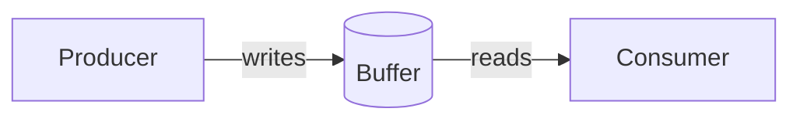

# Personal site

Astro static site, deployed to GitHub Pages. Markdown in, HTML out.

## Everyday use

```bash
npm run dev      # http://localhost:4321, live-reloads as you edit
npm run build    # writes dist/ — the CI does this for you
npm run preview  # serve dist/ exactly as it'll be served in production
```

## Writing a post

Drop a `.md` file in `src/content/blog/`. The filename becomes the URL, so
`ring-buffer.md` publishes at `/blog/ring-buffer/`.

```markdown
---
title: 'A title'
description: 'One or two sentences. Shows in listings, RSS, and search results.'
pubDate: 2026-08-15
tags: ['systems', 'rust']
draft: false
---

Body starts here.
```

`title`, `description`, and `pubDate` are required — the build fails loudly if
one is missing, which is the intent. `draft: true` keeps a post off the site
entirely; it stays visible in `npm run dev`.

Push to `main` and it's live in about two minutes.

### Math

Inline with `$...$`, display with `$$...$$`:

```markdown
The invariant is $0 \le H - T \le N$, or set apart:

$$
\sum_{i=1}^{n} \frac{1}{i^2} \to \frac{\pi^2}{6}
$$
```

Rendered at **build time** by KaTeX, so it arrives as plain HTML. No
JavaScript, works with JS disabled, no layout shift.

### Diagrams

A fenced ` ```mermaid ` block:

````markdown

````

Mermaid runs in the browser, so unlike math this one needs JavaScript. It's
loaded lazily — pages without a diagram download none of it. Flowcharts,
sequence, state, ER, Gantt, class diagrams all work; see
[the Mermaid docs](https://mermaid.js.org/).

### Figures

Put the file in `src/content/blog/images/` and reference it relatively. The
text in quotes becomes a caption:

```markdown

```

Alt and caption do different jobs, so write both: alt *describes* the image to
a screen reader, the caption *adds context* for everyone. Astro converts the
file to WebP, generates the right sizes, and sets width and height so the page
doesn't jump while it loads.

Charts drawn on a white background are dimmed slightly in dark mode — hover to
see one at full brightness.

### Code

Standard fences with a language tag. Highlighted at build time by Shiki, with
separate light and dark themes that follow the page.

### Tables

Plain Markdown tables. Wide ones scroll sideways inside their own box on
narrow screens rather than stretching the page.

## Changing the look

| To change | Edit |
| --- | --- |
| Name, tagline, links, URL | `src/consts.ts` |
| Colours, fonts, sizes, spacing | `src/styles/theme.css` |
| Layout and components | `src/styles/base.css` |
| Page structure | `src/layouts/`, `src/components/` |

`base.css` only reads custom properties, never literal values — so
`theme.css` is the whole surface for a restyle.

Current look: Source Sans 3 for text, JetBrains Mono for code, evergreen
accent, light and dark both supported and following the OS by default.

## First-time GitHub Pages setup

1. Create a public repo named exactly **`<username>.github.io`**.
2. Set `SITE.url` in `src/consts.ts` to `https://<username>.github.io`.
3. In the repo: **Settings → Pages → Build and deployment → Source →
   GitHub Actions**. Not "Deploy from a branch" — the included workflow
   at `.github/workflows/deploy.yml` handles it.
4. Push to `main`.

The Actions tab shows the build. First deploy takes a few minutes; later ones
are faster.

### A custom domain, later

Add a `public/CNAME` file containing just the domain, point a DNS `CNAME`
record at `<username>.github.io`, and set the domain under Settings → Pages.
Update `SITE.url` to match, or canonical URLs and RSS links will still point
at the old address.
