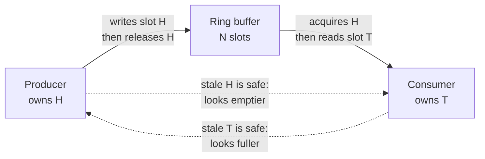

I wanted a bounded queue between one producer thread and one consumer thread
with no mutex on the hot path. The single-producer/single-consumer (SPSC) case
turns out to be dramatically easier than the general one, and the reason is
worth writing down.

## The invariant

Let $H$ be the head index (where the producer writes next) and $T$ the tail
(where the consumer reads next), both monotonically increasing and never
wrapped. The queue holds $H - T$ items, so correctness means maintaining

$$
0 \le H - T \le N
$$

at every observation point, where $N$ is the capacity. The two bounds fail in
different ways: $H - T > N$ means the producer overwrote an unread slot, and
$H - T < 0$ means the consumer read a slot that was never written.

Because only the producer ever increments $H$, and only the consumer ever
increments $T$, each thread has *exact* knowledge of one endpoint and a
*conservative* estimate of the other. That asymmetry is the whole trick.

## Why that makes the ordering cheap

The producer needs to know the queue isn't full. It reads $T$, which the
consumer may have advanced since — but a stale $T$ only ever makes the queue
look *fuller* than it is. The producer might needlessly report `Full`; it can
never overwrite live data.



Symmetrically, a stale $H$ only makes the queue look emptier to the consumer,
so it spuriously reports `Empty` rather than reading a slot mid-write. Both
failure modes are liveness hiccups, not safety violations.

## The code

The load of your *own* index can be `Relaxed` — no other thread writes it. The
load of the *other* index needs `Acquire`, paired with a `Release` store, so
the slot write can't be reordered past the index publication.

```rust
pub fn push(&self, item: T) -> Result<(), Full<T>> {
    let head = self.head.load(Ordering::Relaxed);   // we own it
    let tail = self.tail.load(Ordering::Acquire);   // pairs with pop's Release

    if head.wrapping_sub(tail) == self.capacity {
        return Err(Full(item));
    }

    let slot = head & (self.capacity - 1);          // capacity is a power of 2
    unsafe { self.buffer[slot].get().write(MaybeUninit::new(item)) };

    // Release: the slot write above must be visible before the index moves.
    self.head.store(head.wrapping_add(1), Ordering::Release);
    Ok(())
}
```

Two details that cost me an afternoon each:

1. **Power-of-two capacity.** `head & (capacity - 1)` replaces `head % capacity`.
   A modulo on the hot path was about 20 cycles; the mask is one. It also makes
   `wrapping_add` overflow harmless, since the mask discards the high bits.
2. **`wrapping_sub` for the fill check.** Comparing `head < tail` breaks the
   moment the counters wrap past `usize::MAX`. The subtraction is correct
   across the wrap as long as capacity is smaller than half the index space.

## False sharing

The first working version was slower than a `Mutex<VecDeque>`. `head` and
`tail` sat next to each other in the struct, so they shared a cache line, and
every producer store invalidated the consumer's copy — the coherence traffic
cost more than the lock had.

| Layout                       | Throughput (M ops/s) | vs. mutex |
| ---------------------------- | -------------------- | --------- |
| `Mutex<VecDeque>`            | 11.4                 | 1.00×     |
| Lock-free, shared cache line | 8.7                  | 0.76×     |
| Lock-free, 64-byte padded    | 94.2                 | 8.26×     |

Padding each index to its own cache line is the entire difference:

```rust
#[repr(align(64))]
struct CachePadded<T>(T);
```

> An 8× swing from a struct-layout change is a good reminder that on modern
> hardware the algorithm is often not the thing you're optimising. The
> coherence protocol is.[^1]

## What I'd do differently

Reach for a crate. `crossbeam` has had this for years, with the padding, the
wrap handling, and a far better test suite than mine. Writing it was worth it
for understanding what the crate is doing — but the version I'd ship is theirs.

[^1]: Herlihy & Shavit, *The Art of Multiprocessor Programming*, ch. 3, is the
    clearest treatment of why this happens that I've found.
