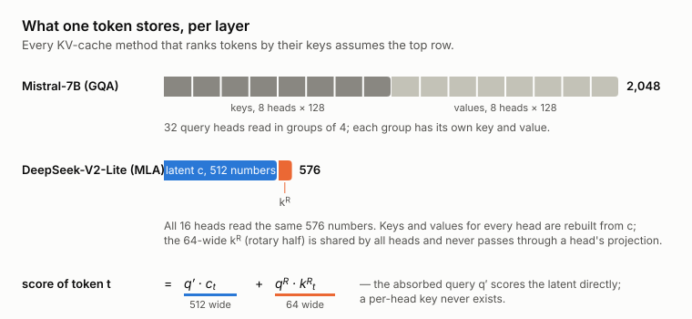
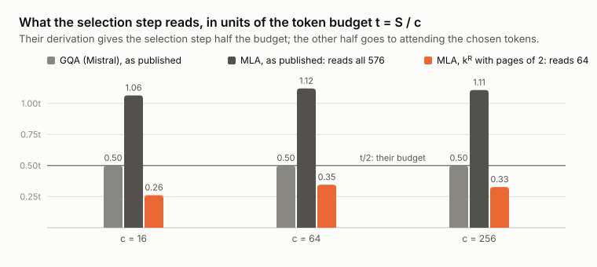
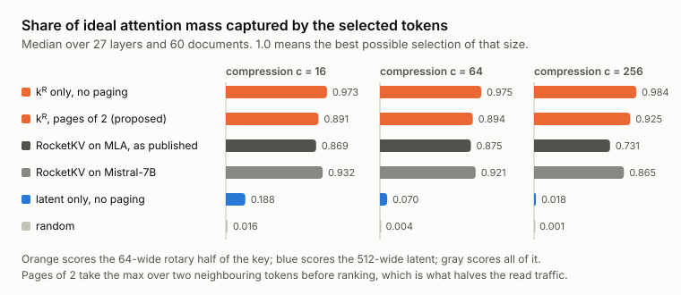
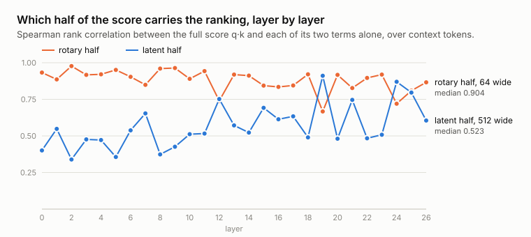

*Managing the KV-cache is the primary challenge for long-context inference. Many of these KV-cache management techniques have been tested on MHA, MQA and GQA, but rarely on MLA. These techniques usually involve ranking or ordering quantities over each attention head's keys, but in MLA the per-head keys are never materialized. I was curious to measure on real weights whether two of these techniques can be adapted for MLA, and if so, whether they survive the move into MLA’s compressed cache.*

## Background: the KV cache and MLA

When a transformer generates text, it keeps a key and a value for every past token at every layer, referred to as the KV cache. For long contexts this cache is the thing that fills the GPU's HBM, and a small cornucopia of techniques exists to make it smaller or to avoid recomputing it. These include reusing cached chunks across requests, evicting tokens the model no longer attends to, and reading only the tokens that matter at each step.

Almost all of these techniques are written for the cache stored by Multihead Attention, Group-Query Attention, or Multiquery Attention, namely one key vector and one value vector per attention head (or per group of heads), per token. These methods compute something over those vectors (how far a key moved, how much attention it would receive, etc) and rank tokens by it.

DeepSeek's Multi-head Latent Attention (MLA) stores something else. Per token and layer it keeps a 512-dim *latent* `c`, plus a 64-dim RoPE key `k^R` that all heads share. The per-head keys and values are rebuilt from `c` by a projection whenever they are needed (and in the efficient implementation they are never rebuilt at all), and the query is folded through the projection instead (this is called "absorption"), so the query scores the latent directly.



*Figure 1. Per token and layer, Mistral-7B (GQA) stores 2,048 numbers; DeepSeek-V2-Lite stores 576. On MLA the attention score has two terms, the absorbed query against the 512-dim latent, and the rotary query against the 64-dim shared key.*

So the question is, can those per-head quantities the techniques depend on be computed in MLA's latent space, and do the token rankings they produce survive? I picked one technique from each family — CacheBlend (Yao, 2025) for cache reuse, RocketKV (NVIDIA, 2025) for token selection — and measured.

## Two papers that address the problem of long-context KV caches

**RocketKV** (NVIDIA, 2025) compresses the cache for decoding in two stages. Stage one permanently evicts tokens the prompt never attended to. Stage two, at every decode step, estimates which of the surviving tokens the current query will attend to and reads only those. The estimate is cheap since it keeps only the largest coordinates of the query, takes an elementwise max over small pages of keys, and averages the resulting attention across heads that share a key. The paper derives the whole thing from one budget `c` (the target compression ratio). With `S` tokens in context the method may touch `t = S/c` tokens' worth of memory per step, half for the estimate and half for attending to the tokens it picks. The quantity it ranks by is an estimated attention score, built from per-head keys.

**CacheBlend** (Yao, 2025) reuses the KV cache of text chunks the model has seen before, even when they appear in a new order or alongside new chunks. This is particularly useful for RAG applications, where chunks of text, or documents, can be passed as input to a model in arbitrary order. Due to the nature of self-attention, a document's attention matrix will be slightly different depending on which previous tokens it attends to. If a key is computed independently (i.e, not having attended to the previous context), it can be slightly wrong if reused within the context of other, new documents, because the token's attention over its new neighbours was never computed. CacheBlend recomputes only the tokens whose keys and values moved the most (the top 15% by deviation) and relies on an observation that the tokens most deviated at one layer are the most deviated at the next, so a check at an early layer picks the tokens for later ones. The quantity it ranks by is the per-head key's deviation. 

## Setup

**Model under test**: `DeepSeek-V2-Lite` — 27 layers, 16 heads, a 512-dim latent and a 64-dim `k^R`. As a control I used `Mistral-7B-Instruct-v0.2` which uses 32 query heads sharing 8 key/value heads (the architecture RocketKV was built for, running RocketKV's own released selection code). 

**The port**: RocketKV's released code assumes one key per head, which MLA does not have, so on DeepSeek I re-implemented its selection step rather than running the code as-is. The steps are the paper's, in order: one sign per coordinate shared across heads, an elementwise max over each page of keys, keep the coordinates where the query is largest, score pages on those coordinates, rescale by how much query magnitude survived, softmax, average across heads, pick the top tokens. The budget is derived the way their code derives it, from the stage-two ratio. Two things change because the architecture forces them. The key being scored is the stored `[c; k^R]`, 576 numbers, and the query is the absorbed `[q'; q^R]`. The head-averaging covers all 16 heads, since they share one stored key, where on Mistral it covers a group of four. I did make one design change - the 64 RoPE coordinates are always kept through the coordinate-reduction step, because the paper's reduction is defined over a key that does not split them out.

**Data**: 60 multi-hop question-answering documents from MuSiQue, 1,379 to 4,457 tokens each (median 2,414). One rented GPU session on a Lambda Labs A100 captured the caches and queries in bfloat16. After that I ran on a laptop against the captured tensors and the model's real projection weights.

The measurement for selection is **share of ideal**. At one layer, take the real attention weights of the last prompt token over the context. A selector picks `keep` tokens. Its score is the attention mass on the tokens it picked, divided by the mass on the `keep` tokens the model actually attends to most. One critical detail is that the ideal is restricted to what the selector could have chosen. On MLA every head shares one token set, so the ideal is one set chosen on head-averaged attention, and on Mistral it is one set per group of four heads.

Before trusting any of it I checked that scoring from the latent reproduces the model's own attention. On the real DeepSeek-V2-Lite, with `output_attentions=True`, the two agree with Spearman 0.99996 and a top-15% overlap of 0.989 at layers 0, 13 and 26. With this, my calculation and the model's own attention values are aligned.

## CacheBlend

For CacheBlend each head's key is a linear function of the latent, `W_h c`, with the shared rotary key `k^R` appended. So the squared deviation of all heads' keys together is a quadratic form in the latent's deviation plus one rotary term, counted once per head because every head shares it:

```
Σ_h ‖Δk_h‖²  =  Δcᵀ (Σ_h W_hᵀ W_h) Δc  +  H ‖Δk^R‖²
```

The matrix in the middle is 512 × 512, computed once per layer from the weights. So CacheBlend's exact ranking quantity is computable without materializing a single per-head key. Checked against keys rebuilt the slow/exact way, the relative error is 1.0e-06 over 60 documents, or negligible.

While the above method scores only the keys, as in the original CacheBlend paper, for MLA, it is advantageous to build the matrix from the whole `kv_b_proj` (aka, the upprojection matrix), with the key and value blocks together, instead of the key block alone. Computationally, it is the same cost, and it scores the value's deviation too, which the key-only identity does not. Against the exact key ranking it keeps 0.953 of the top-15% set (rank correlation 0.998). This provides the highest value signal. The matrix-free alternative, the plain squared deviation of the 576 stored numbers, keeps 0.847; the latent alone, dropping `k^R`, keeps 0.752.

CacheBlend's cross-layer observation also seems to extend well to MLA. The deviation ranking at one layer predicts the next layer's at Spearman 0.946.

One caveat to keep in mind, is that early in the network, 95% of the staleness comes from the 64-dim `k^R`, not the 512-dim latent, which is why dropping `k^R` fails.

## RocketKV, part 1: the budget arithmetic

RocketKV's selection step scores a compressed summary of each page of keys. To score it, the memory cost amounts to the number of pages times the width of the summary. Substituting the paper's own formula for how many pages survive, the page size cancels and the cost becomes

```
selection traffic  =  t × (summary width) / (numbers stored per token)
```

On Mistral the summary is a key and a key is half of what a token stores (the value is the other half, and it is only fetched for tokens that survive selection). So the selection step costs exactly `t/2`, which is exactly the half the paper assigns it. The derivation is built around this identity, and applies for every compression ratio.

On MLA the value is rebuilt from the same latent that is being scored. Since you have to read the entire latent anyway, the ratio is close to 1 and the selection step alone costs about `1.1t`, more than the whole budget.



*Figure 2. Selection-step traffic in units of the budget `t`. Mistral lands on `t/2` exactly. MLA as published pays 1.06–1.12`t` for the selection step alone; scoring only the 64-dim `k^R` with pages of two brings it to 0.26–0.35`t`.*

When asked for 64× compression, vanilla RocketKV on MLA would deliver 39.5×, based on the arithmetic above. To adapt the method for MLA, the fix is to send more of the compression to stage one (aka, evict more tokens initially), or to summarize far less of each token than it does now.

## RocketKV, part 2: the latent barely ranks tokens

My initial expectation was in RocketKV's query-coordinate reduction. Scoring keys on only the largest coordinates of a query that has been folded through a 512-dim projection seemed unlikely to work. That turned out to be the contrary. The paper's derivation keeps about half the coordinates at every budget, and at that setting switching the reduction off changes share of ideal by less than 0.006 on either architecture, with the small difference in the reduction's favour.

The interesting failure was somewhere else. On MLA the attention score has two terms (Figure 1), the absorbed query against the 512-dim latent, and the rotary query against the 64-dim k^R. I scored tokens on each term alone.



*Figure 3. Share of ideal attention mass for six selectors at three compression ratios. Scoring the 64-dim RoPE dimension alone captures 0.97–0.98. Scoring the 512-dim latent alone captures 0.19 at the loosest budget and 0.02 at the tightest.*

The 64 RoPE dims carry the ranking. The cached latent contributes almost nothing to the ordering. RocketKV's selection step, ported as described in Setup, reads all 576 numbers and lands within a few hundredths of `k^R` alone with the same page max applied, so the 512 latent dims are being read and paid for without changing the result.

The reason is scale. The latent passes through a layer norm and `k^R` does not. Over 27 layers, 16 heads and 60 documents, the rotary term's spread across context tokens is 2.08× the latent term's, and the two terms are close to independent, which makes the RoPE dims far more useful for ranking.



*Figure 4. Rank correlation between the full score and each term alone, by layer. The rotary half leads in 24 of 27 layers; the latent takes over at layers 12, 19 and 24.*

The obvious objection is that `k^R` is the *rotary* key (meaning, it carries some notion of position) so maybe it is just picking recent tokens. I do not think that it is, because `k^R` is a 64-dim projection of the token's *content* that is then rotated by position. But it is still a projection of the token's hidden state. To confirm, I kept every rotation at its own position but shuffled which token's content sits in that position and re-ran the scoring. With the shuffle, the `k^R` selection collapses from 0.898 to 0.011. However, a caveat is that the first context token (the "attention sink") carries a lot of attention mass (0.605 of ideal) on its own, so any selection that includes it tends to do well. However, even with the attention sink included, the `k^R` dims added 0.29-0.36 of attention mass on top of that, while the latent adds almost nothing (0.07).

## Applying the fix

If the 64 numbers carry the ranking, the selection step should read those 64 instead of all 576. That drops its traffic by 9×, which turns the page size into a free parameter. Pages of two dominate the published setting on both axes at every budget:

| asked `c` | setting | selection traffic | delivered ratio | share of ideal |
|---|---|---|---|---|
| 16 | as published | 1.06`t` | 10.2× | 0.869 |
| 16 | `k^R`, pages of 2 | 0.26`t` | **21.0×** | **0.891** |
| 64 | as published | 1.12`t` | 39.5× | 0.875 |
| 64 | `k^R`, pages of 2 | 0.35`t` | **75.6×** | **0.894** |
| 256 | as published | 1.11`t` | 159× | 0.731 |
| 256 | `k^R`, pages of 2 | 0.33`t` | **309×** | **0.925** |

It also meets the budget the paper's own derivation asks for.

## Trying to break it

I tried a few things to falsify this finding:

- **Softmax temperature.** The method divides page scores by a factor that depends on the width of what is scored, so each variant ran at a different sharpness, and the head-averaging step is sharpness-dependent. Forcing every variant to the model's own sharpness moved no `k^R` variant by more than 0.014 and made the latent *worse* (0.070 → 0.049 at `c = 64`). The natural temperature had been helping the latent's scores.
- **Which query token.** Every headline number scores the last prompt token. Across 16 stored query positions the spread ratio stays within 1.82–2.08 and `k^R` selection within 0.89–0.92.
- **Query distance.** Re-rotating the query up to 1,024 tokens further from the context changes the ratio by less than 0.04. Beyond 4,096 the attention collapses onto a handful of tokens and every selector scores 1.0, so the measurement degenerates rather than improving.
- **Rotation versus content**, the shuffle above.
- **The sink**, the sink check above.
- **The instrument itself**, the Spearman 0.99996 agreement with the model's own attention, at the content-dominated end of the network as well as the rotary-dominated middle.

## What I would do next

- Implement the `k^R`-only selection inside MLA attention and measure end-task accuracy on a long-context benchmark.
- Measure real bandwidth rather than counting bytes.
- Test RocketKV stage-one eviction.
- Test on a larger, 128-head model, where the shared coordinate set spans eight times as many per-head bases.

Code, captured results and the claims ledger with every number's provenance are at [github.com/tejkas/absorbkv](https://github.com/tejkas/absorbkv). Every number in the figures is in `results/*.json`.
