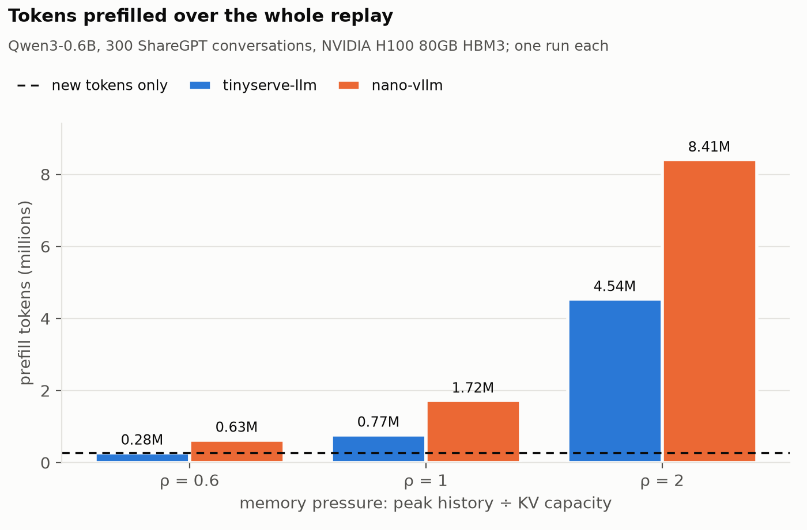
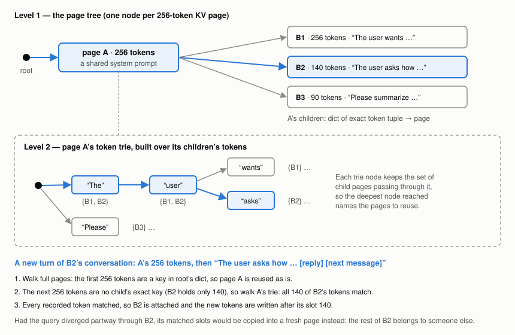
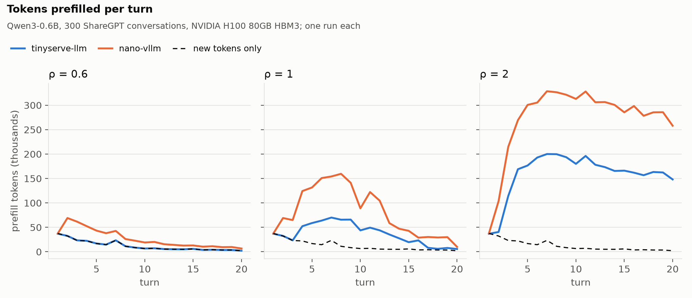
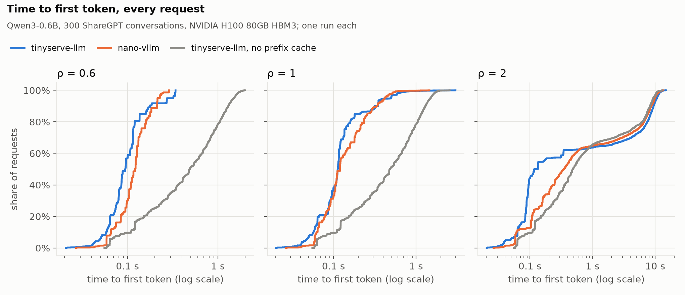

tinyserve-llm is a small LLM inference engine I built around clean KV cache management. It runs
Llama 3.2 1B and Qwen3-0.6B weights on flash-attn, with paged KV, a prefix cache, copy-on-write
forking and a cache-aware scheduler, in about 2,100 lines of Python plus one Triton kernel.

To compare, I used [nano-vllm](https://github.com/GeeeekExplorer/nano-vllm), a similarly lightweight inference engine.
Replaying 300 multi-turn ShareGPT conversations with the same amount of KV memory, tinyserve-llm gets
the median request its first token sooner at every level of memory pressure, and **2.7× sooner**
(0.13 s against 0.35 s) when the cache holds only half of what the conversations need. Behind that
is prefill: nano-vllm prefills **2.3×** as many tokens as tinyserve-llm when memory is plentiful,
and still **1.85×** as many at half, at equivalent throughput. Most of the gains come from 
the particular data structure used for page management, which in this case is a tree of KV pages with a token trie on each page, 
bridging the approaches taken by vLLM (paged KV cache blocks with longest-prefix matching at the block level) and SGLang
(a token trie that matches at the token granularity). The hybrid approach retains a paged KV-cache structure while also benefiting
from the strengths of granular token matching.

## The problem: 256-token pages

In a multi-turn chat, every turn resends the whole conversation. A prefix cache keeps the KV of
earlier turns, so only the new message has to be prefilled. How much of the history it can reuse
depends on how finely it can match.

The public flash-attn package only accepts a paged KV cache whose page size is a multiple of 256
tokens. A cache that matches whole pages, as nano-vllm's does, can't reuse the last, partly filled
page of a conversation, so it recomputes those tokens on every turn, about half a page on average,
however much memory is free. On the trace used here, nano-vllm recomputes 126 extra tokens per
turn when nothing is ever evicted, almost exactly half of 256.

Larger engines get around this with small pages. vLLM defaults to 16-token blocks, through its
own fork of flash-attn, and SGLang defaults to pages of one token (token-level). Both still reuse whole pages
only, but small pages just keep the unreusable tail short to minimize recomputation. But can we keep the
big pages the public kernel wants, and still reuse history at single-token granularity?

## The page tree and the token trie

The prefix cache is two indexes, one inside the other.

**Level 1: a tree of pages.** Each node is one KV page, holding up to 256 tokens. A node's
children are the pages that have followed it in some cached sequence, kept in a dict keyed by the
child's exact token tuple. A lookup walks the prompt 256 tokens at a time, following exact keys.
A lookup only ever compares against one parent's children, so a page's position in the tree already encodes everything before it, 
and two identical pages under different parents can't be confused. Since the dict compares the actual tuples, a false match is
impossible.

**Level 2: a token trie on each page.** When no child matches the next 256 tokens exactly, the
lookup needs the child sharing the *longest leading run* with the prompt. Every page carries a
trie built over its children's tokens: one trie node per token position, each holding the set of
child pages that pass through it. Walking the prompt's tokens down the trie until it diverges
gives the match length, and the deepest node reached names the pages that hold those tokens.

A page usually has one or two children, but not always. The page where a shared system prompt
ends can have one child per conversation that used it, and every new conversation's lookup lands
there. With 100 children and a 120-token shared run, comparing the prompt against each child in a
Python loop took 245 µs; the trie takes 3.3 µs. A scheduler that prices 100 waiting requests every
step would spend about 25 ms per step on the loop.

**What a match does.** The lookup returns some full pages plus, possibly, a partial match inside
one more page. There are two cases:

- **The prompt matched every token the page holds.** This is the multi-turn case: last turn's
  final page was published with, say, 140 tokens, and this turn's prompt starts with all 140. The
  new sequence attaches the page and keeps writing after slot 140. If another sequence still holds
  it, copy-on-write gives the writer its own copy first.
- **The prompt diverged partway through the page.** The page's remaining slots belong to some
  other conversation, so writing into them would overwrite its history. Instead, the matched slots
  are copied into a fresh page, and prefill starts at the first token that differs.

Either way, prefill starts at the exact token where the cached history ends, not at the last page
boundary before it.

**Keeping the tree consistent.**

- **Publishing:** a page is published when it fills, or when its sequence finishes or is
  preempted, and only with tokens whose KV has actually been written.
- **Dedupe:** if a page with the same tokens already exists under the same parent, the sequence
  switches to the existing page and frees its own.
- **Eviction:** LRU, restricted to free leaf pages. A child's KV was computed in its parent's
  context, at positions that depend on everything before it, so a child must never outlive its
  parent. A parent is always used at least as recently as its children, so LRU over leaves never
  breaks that rule.

**The cost.** It's more code and more pointer chasing than a hash map, and a partial match that
diverges costs one page copy at admission.

> **Prior art.** SGLang's [RadixAttention](https://arxiv.org/abs/2312.07104) keeps its prefix
> cache as a radix tree over tokens, with one-token pages and LRU eviction of leaves; this
> structure is that idea adapted to large pages. With larger pages, which some of its attention
> backends require, SGLang matches whole pages only. vLLM identifies each full block by a hash
> chained from its parent's, and caches full blocks only. nano-vllm does the same with 256-token
> blocks.

## Other decisions, briefly

- **Ref-counted pages with copy-on-write.** Forking a sequence (n > 1 samples) shares every page,
  including the partly filled last one. The first write to a shared page copies it. With 256-token
  pages, a fork almost always lands mid-page, so sharing only full pages would mean each branch
  recomputes about 128 tokens.
- **Block-first KV layout, `[pages, layers, 256, heads, head_dim]`.** One page's KV across all
  layers is one contiguous chunk, so copying a page, and later moving it to CPU, is a single
  operation instead of one per layer. flash-attn accepts the strided per-layer views.
- **A Triton store kernel instead of a padding page.** Padded rows carry slot -1 and the kernel
  skips them. The alternatives were a reserved page that wastes 256 slots, or a mask in PyTorch,
  which syncs with the host on every layer and can't be captured in a CUDA graph.
- **Cache-aware scheduling with aging.** Waiting requests are ranked by how many of their tokens
  are already cached, plus a weight times how long they've waited, so requests with long cached
  prefixes go first and cold ones aren't starved.
- **One narrow interface between the engine and the cache.** The engine only calls allocate,
  append, commit, release and fork, so the cache's policy can change without touching model code.

## Is it correct?

A fast engine that computes the wrong thing is worthless, so before any benchmark I checked the
outputs against Hugging Face's `transformers`. For 8 chat prompts on real Llama 3.2 1B weights, I
fed each prompt plus tinyserve-llm's reply through the HF model in one forward pass and checked, at
every position, whether our token was HF's top choice. 503 of 509 were. The other 6 were within
0.125 logits of HF's choice: near ties, at the scale where bf16 rounding decides them. The second wave of prompts reused 858 cached tokens each, so the check covers the
prefix cache too.

## How I measured

- **Workload:** 300 ShareGPT conversations with at least 3 turns, cut to fit 16k tokens; a median
  of 6 turns, up to 54. Each turn's prompt is the conversation so far, *as token ids*, with each
  engine's own generated replies fed back. Every reply is generated to exactly the dataset reply's
  length, so both engines see prompts of the same length.
- **Turns run in waves:** one `generate()` call per turn index, with every conversation that has
  that turn. This is the only way to drive nano-vllm, which has no server.
- **Memory pressure:** ρ = the KV the cache would need to keep every live history ÷ its capacity.
  At ρ 0.6 nothing has to be evicted; at ρ 2 the cache holds half of what's needed. Both engines
  get exactly the same number of pages.
- **Engines:** stock nano-vllm at a fixed commit, unmodified, with its counts read from outside by
  wrapping three methods. CUDA graphs off in both: nano-vllm supports them, but tinyserve-llm doesn't
  yet, so nano-vllm ran with `enforce_eager=True`. Qwen3-0.6B on one H100 per run.
- **Metrics:** time to first token, from the start of a request's turn to its first generated token,
  so it includes any wait for memory. And prefill tokens, meaning the prompt tokens each engine
  actually ran through the model. Prefill counts work, doesn't depend on the GPU, and has an exact
  floor: each turn's new message, which no cache can skip. Here that's 274,440 tokens.
- **One run per configuration.** In a rehearsal on Llama, three repeats agreed to within 0.01% on
  prefill tokens and 1% on throughput.

## Results

| ρ | median TTFT, s (ours / nano) | tinyserve-llm prefill | nano-vllm prefill | nano ÷ ours | output tok/s (ours / nano) | preemptions (ours / nano) |
|---|---|---|---|---|---|---|
| 0.6 | 0.094 / 0.121 | 276,681 (1.01× floor) | 629,213 | 2.3× | 1,112 / 1,126 | 0 / 0 |
| 1 | 0.112 / 0.120 | 773,457 | 1,720,029 | 2.2× | 1,124 / 1,121 | 0 / 4 |
| 2 | 0.129 / 0.349 | 4,536,766 | 8,409,016 | 1.85× | 951 / 930 | 56 / 251 |

At ρ 0.6, tinyserve-llm prefills 1.01× the floor: apart from each turn's new message, it
recomputes almost nothing. nano-vllm's extra 353k tokens there are all the partial last page.

At ρ 1 and 2 the cache has to evict, and both engines recompute evicted history. I expected the
gap to shrink to 1.2–1.5× at ρ 2, since the half-page saving becomes a small share of a much
larger total. It didn't: nano-vllm preempted 251 times against our 56, and a preempted request
recomputes its whole prompt plus everything generated so far. I haven't measured how much of the
gap that accounts for.

Time to first token is where a user feels the difference. At ρ 0.6 and 1, nearly every request on
either engine gets its first token within half a second, ours a little sooner: a median of 0.094 s
against 0.121 s at ρ 0.6. Without the prefix cache, the median is 0.49 s.

At ρ 2 the picture splits in two. The cache holds about half of what each turn needs, so roughly a
third of requests, on every engine and with or without caching, wait about 10 seconds for earlier
requests to finish and free memory. No cache policy can fix that. Below that line the cache matters:
the median request waits 0.13 s on tinyserve-llm and 0.35 s on nano-vllm, and 45% of requests
start within 0.1 s, against nano-vllm's 13%. Above it, our tail is slightly heavier (27.6% of
requests wait over 5 s, against nano-vllm's 25.3%), because our scheduler makes new requests wait
for memory rather than preempting running ones: 56 preemptions to its 251.

Throughput is a tie. This workload spends most of its time generating replies, so skipping
prefill barely moves output tokens per second, and per-step overhead dominates. CUDA graphs cut that
overhead; once tinyserve-llm has them, I'll rerun both engines with graphs on.

## What's next

HTTP serving, CPU offload of evicted pages (so pressure costs a transfer instead of a recompute),
CUDA graphs, and chunked prefill. The code is at
[github.com/tejkas/kv-cache-manager](https://github.com/tejkas/kv-cache-manager).
